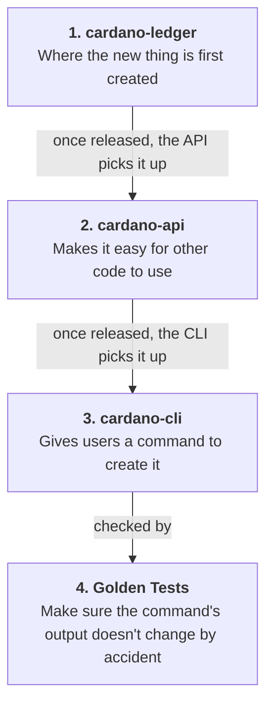

# Architecture Map: From cardano-ledger to cardano-api to cardano-cli

When the ledger adds something new, like a new kind of certificate, it doesn't reach the CLI right away. It starts in cardano-ledger. Then cardano-api adds support for it, cardano-cli adds a command that uses it, and tests check that the output doesn't change by accident. Each repo waits for the one below it to publish a release before picking up the change.

## How a change flows

1.  The ledger team adds the change and releases new packages to CHaP, the Cardano package repository.
2.  cardano-api moves to the new ledger versions, exposes the new type, and adds a function to build it.
3.  cardano-api adds test generators and round-trip tests, then makes a release.
4.  cardano-cli moves to the new cardano-api and adds a command that calls that function and writes the result to a file.
5.  cardano-cli also handles the new item where it is read back (for example transaction build) and displayed (transaction view).
6.  Golden tests record the command's output and help reviewers check the differences.

### Example

`cardano-cli conway governance drep update-certificate` parses its arguments and calls cardano-api's `makeDrepUpdateCertificate`. That function asks the ledger to build the certificate. The CLI then writes it to a file, and a golden test compares that file with a stored copy.